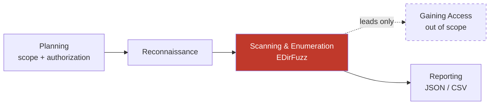

# EDirFuzz

**Enhanced Directory Fuzzer with Real-Time and Adaptive Request Rate Control**

> [!WARNING]
> For authorized security testing only. Unauthorized use may be an offence under Malaysia's **Computer Crimes Act 1997**. See the [Legal Disclaimer](#legal-disclaimer).

---

## Description

EDirFuzz is a Python command-line tool for authorized web directory and file enumeration. It requests paths from a wordlist and classifies each HTTP response to discover hidden or unlinked content such as admin panels, login pages and backup files.

Conventional fuzzers send requests at a fixed speed set before the scan starts, which can overload a target. EDirFuzz treats request rate as a live safety control:

- **Real-time rate control:** the operator can change the request rate during an active scan without restarting it.
- **Adaptive backoff:** with `--adaptive`, the rate is halved after repeated HTTP 429, 503 or timeouts, reduced on high latency, and recovered gradually when the target is stable (minimum 1 req/s).
- **Central scheduler:** every request passes through one scheduler with a hard cap of 100 req/s.
- **Scope enforcement:** every target and redirect is checked against an authorized scope before any request is sent.

Responses are classified as `FOUND` (200), `REDIRECT` (301/302/307/308), `AUTH_REQUIRED` (401), `FORBIDDEN` (403), `NOT_FOUND` (404), `RATE_LIMITED` (429), `SERVER_ERROR` (5xx), `ERROR` (no response), or `OTHER`.

**Architecture**


---

## Attack Category

**Web Application Attack:** web content discovery / forced browsing (directory and file enumeration).

Related references: OWASP WSTG-CONF-04 and WSTG-CONF-05; MITRE ATT&CK T1595.003 (Active Scanning: Wordlist Scanning).

---

## Attack Lifecycle Mapping

| Phase | Role of EDirFuzz |
|---|---|
| **Planning** | Requires a declared target and scope, shows the legal banner and requires a typed `YES`. `--dry-run` previews the scan without sending traffic. |
| **Reconnaissance** | Indirect: recon results inform the choice of target and wordlist. |
| **Scanning & Enumeration** | **Primary phase.** Enumerates directories and files, classifies responses and controls request rate live and adaptively. |
| **Gaining Access** | Not performed by design. Findings are leads for manual, authorized follow-up. |
| **Maintaining Access** | Not applicable. |
| **Covering Tracks** | Inverted: the tool keeps a timestamped, auditable record instead of hiding activity. |
| **Reporting** | Produces timestamped JSON/CSV reports with a summary by classification. |



---

## Installation

**Requirements:** Python 3.10+ and Git (Windows, Linux or macOS).

```bash
git clone https://github.com/zzerahh/edirfuzz.git
cd edirfuzz
python -m venv .venv
.\.venv\Scripts\Activate.ps1      # Windows PowerShell
# source .venv/bin/activate       # Linux / macOS
pip install -e .
pip install -r requirements.txt   # includes pytest for running tests
edirfuzz --help
```

Start the local test lab in a separate terminal before scanning. It listens only on `http://127.0.0.1:5000`:

```bash
python lab/app.py
```

---

## Usage Examples

Run commands from the repository root. `edirfuzz` and `python main.py` are equivalent. During a scan, type a number and press **Enter** to change the rate, or press **Ctrl+C** to stop safely.

| Option | Default | Description |
|---|---|---|
| `-t, --target` | `http://127.0.0.1:5000` | Base URL to scan |
| `-w, --wordlist` | `wordlists/common.txt` | Path wordlist |
| `--initial-rate` / `--max-rate` | `5` / `30` | Starting and maximum req/s (hard cap 100) |
| `--adaptive` | off | Enable adaptive backoff |
| `--dry-run` | off | Show the scan plan without sending requests |
| `--format` | `json` | `json`, `csv` or `both` |
| `--allow-host` | — | Add an authorized host, IP or CIDR (written permission required) |

**1. Dry run**
```bash
edirfuzz --dry-run
```


**2. Basic scan with JSON and CSV reports**
```bash
edirfuzz -w wordlists/common.txt --format both
```


**3. Live rate change** (type `10` and press Enter during the scan)
```bash
edirfuzz -w wordlists/rate_test.txt --initial-rate 2 --max-rate 20
```


**4. Adaptive backoff** (10 → 5 → 2.5 → 1.25 → 1 req/s)
```bash
edirfuzz -w wordlists/adaptive_test.txt --initial-rate 10 --max-rate 20 --adaptive
```


**5. Kill switch** (press Ctrl+C; a `_partial` report is saved)
```bash
edirfuzz -w wordlists/rate_test.txt --initial-rate 2 --format both
```


**6. Out-of-scope target rejected**
```bash
edirfuzz -t http://8.8.8.8
```


**7. Automated tests** (with the lab running)
```bash
python -m pytest -q
```


---

## Ethical Considerations

| Safeguard | Purpose |
|---|---|
| **Legal banner and typed `YES`** | Every run displays a Computer Crimes Act 1997 notice and requires explicit confirmation before any request. `--yes` is accepted only for safe default targets. |
| **Safe defaults** | The default target is `127.0.0.1:5000`. The default scope is limited to localhost, `127.0.0.0/8`, `::1`, `example.com` and the RFC 5737 test ranges. |
| **Scope enforcement** | Other hosts must be added individually with `--allow-host` (no wildcards, no range broader than /16). Redirects are never followed and are scope-checked. |
| **Rate limits and adaptive backoff** | A hard 100 req/s cap and automatic slowdown prevent service disruption. |
| **Dry run and kill switch** | `--dry-run` allows review before any traffic; `Ctrl+C` stops immediately and saves a partial report. |
| **Data handling** | Reports are stored only in the local `output/` folder, labelled `scan_<host>_<timestamp>[_partial]`, and excluded by `.gitignore`. Only metadata (status, size, timing, redirect, classification) is stored, never response bodies, cookies, headers or credentials. Nothing is uploaded. |
| **No exploitation** | The tool performs enumeration only; findings require separate authorization to verify. |

---

## Rules of Engagement

| Item | Rule |
|---|---|
| **Authorized scope** | Systems you own (localhost and the bundled lab), environments designated by the lecturer, or hosts named in a **written** authorization and added with `--allow-host`. Third-party, UniKL production, government and cloud/CDN systems are always out of scope unless authorized in writing. |
| **Time windows** | Lab testing at any time. External testing only within the window agreed in writing (e.g. Mon–Fri, 22:00–06:00 MYT), with the owner notified before and after each session. No testing during change freezes or peak periods. |
| **Permitted techniques** | HTTP `GET` requests for wordlist paths within the agreed rate (recommended ≤ 5 req/s with `--adaptive` on real targets), and recording response metadata. |
| **Prohibited actions** | Scanning unauthorized hosts; bypassing scope checks, rate caps or the authorization prompt; credential guessing or form submission; exploiting, downloading, modifying or deleting discovered content; denial of service; detection evasion; sharing findings outside the engagement. |
| **Emergency stop** | Press **Ctrl+C** on unexpected errors, timeouts, an unexpected host, a stop request or any doubt about scope. Confirm the kill-switch message, keep the `_partial` report, notify the system owner with times, target and rate used, and resume only with their approval at a lower rate. |

---

## Responsible Disclosure

| | Guidance |
|---|---|
| **Who** | The system owner's contact named in the authorization (or their `security.txt` / disclosure policy). For coursework, the course lecturer. Never disclose publicly or to unrelated parties. |
| **When** | Critical exposures (e.g. reachable backups, unauthenticated admin panels) within **24 hours**; other findings in the final report. Allow a reasonable remediation period (commonly 90 days) before any agreed public discussion. |
| **How** | Through the agreed secure channel, including the affected URL, status and classification, timestamp, impact, report file and a remediation suggestion. Describe sensitive content rather than attaching it. |
| **Escalation** | If the owner cannot be reached and the exposure is an active public risk, report to **MyCERT (CyberSecurity Malaysia) via Cyber999**. |

Vulnerabilities in EDirFuzz itself should be reported privately through GitHub's **Security → Report a vulnerability**, not as a public issue.

---

## Legal Disclaimer

EDirFuzz is provided solely for **educational purposes and authorized security testing**. Unauthorized access to computer material is an offence under Malaysia's **Computer Crimes Act 1997 (Act 563)**, including Sections 3, 4 and 5. By using this tool, you confirm that you have explicit written permission from the owner of every system you test and accept full responsibility for your actions. The developers and Universiti Kuala Lumpur accept no liability for misuse or damage. The software is provided "as is" under the [MIT License](LICENSE).

---

## Limitations

- Requests are sent sequentially, so the effective rate is limited by the target's response time.
- Classification is based on status codes only; there is no soft-404 or wildcard detection.
- With `--adaptive` enabled, a manual rate change may be overridden by the adaptive controller.
- GET requests only, with no recursion, extension appending, custom headers or authentication.
- Redirects are recorded but not followed.
- Live rate input requires an interactive terminal.
- RoE time windows are not enforced by the tool.
- Tested mainly against the local Flask lab with small demonstration wordlists.
- Findings are leads, not confirmed vulnerabilities, and require manual authorized verification.
