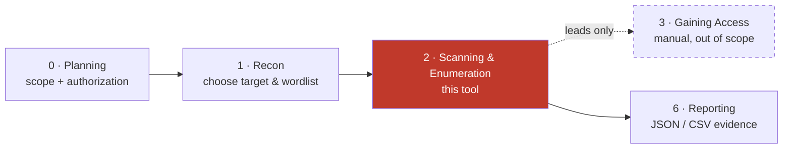

# Enhanced Directory Fuzzer

> [!WARNING]
> **For authorized security testing only.** Running this tool against a system without the owner's explicit written permission may be an offence under Malaysia's **Computer Crimes Act 1997**. Read the [Legal Disclaimer](#legal-disclaimer) and [Rules of Engagement](#rules-of-engagement-roe) before use.

*IKB31603 Ethical Hacking · Universiti Kuala Lumpur MIIT · October 2026*

---

## Tool Description

**Enhanced Directory Fuzzer** is a Python command-line tool for authorized web directory and file enumeration. It requests candidate paths from a wordlist and classifies each HTTP response to find hidden or unlinked content such as admin panels, login pages and backup files.

Conventional directory fuzzers send requests at a fixed speed chosen before the scan starts. If that speed is too aggressive, the target slows down, starts returning `429 Too Many Requests` or `503 Service Unavailable`, or stops responding. This tool treats request rate as a live safety control:

- **Live rate control.** The operator can change the request rate while the scan is running, without restarting it.
- **Adaptive backoff.** With `--adaptive`, the tool halves its rate after repeated 429, 503 or timeout responses, slows down when latency is high, and recovers gradually once the target is stable again.
- **Central scheduler.** Every request passes through a single shared `RateScheduler`, with a hard ceiling of 100 req/s that cannot be overridden from the command line.
- **Scope enforcement.** Every target and redirect destination is checked against an authorized scope before anything is sent.

Responses are classified as `FOUND` (200), `REDIRECT` (301/302/307/308), `AUTH_REQUIRED` (401), `FORBIDDEN` (403), `NOT_FOUND` (404), `RATE_LIMITED` (429), `SERVER_ERROR` (5xx), `ERROR` (no response) or `OTHER`.

### Architecture


---

## Attack Category

| Field | Value |
|---|---|
| **Category** | Web Application Attack |
| **Technique** | Web content discovery / forced browsing (directory and file enumeration) |
| **Related references** | OWASP WSTG-CONF-04 *(Review Old Backup and Unreferenced Files)*, WSTG-CONF-05 *(Enumerate Infrastructure and Application Admin Interfaces)*; MITRE ATT&CK T1595.003 *(Active Scanning: Wordlist Scanning)* |

---

## Attack Lifecycle Mapping

| Phase | Role of the tool | Implemented by |
|---|---|---|
| **0. Pre-engagement / Planning** | Requires a declared target and scope, shows the legal banner and requires a typed `YES`. `--dry-run` previews scope, rate and estimated duration before any traffic is sent. | `main.py`, `core/scope.py` |
| **1. Reconnaissance** | *Indirect.* Passive recon results inform target selection and wordlist choice. The tool performs no passive OSINT itself. | Operator, `wordlists/` |
| **2. Scanning & Enumeration** | **Primary phase.** Actively enumerates directories and files, classifies responses, and controls request pressure live and adaptively. | `core/scanner.py`, `core/analyzer.py`, `core/scheduler.py`, `core/adaptive.py` |
| **3. Gaining Access** | **Deliberately not performed.** Results such as `/admin` (200) or `/secret` (403) are leads for manual, authorized follow-up. The tool never submits credentials, exploits or payloads. | — |
| **4. Maintaining Access** | Not applicable. The tool has no persistence capability. | — |
| **5. Covering Tracks** | Inverted. The tool creates an auditable trail (timestamped per-request records and a configuration snapshot) instead of hiding activity. | `core/reporter.py` |
| **6. Reporting** | Produces timestamped JSON/CSV evidence with a summary by classification. | `core/reporter.py` |



---

## Installation

**Requirements:** Python 3.10 or newer and Git. Tested on Windows 10/11 (PowerShell) and Linux.

```bash
# 1. Clone the repository
git clone https://github.com/zzerahh/enhanced-directory-fuzzer.git
cd enhanced-directory-fuzzer

# 2. Create and activate a virtual environment
python -m venv .venv
# Windows (PowerShell)
.venv\Scripts\Activate.ps1
# Linux / macOS
source .venv/bin/activate

# 3. Install dependencies
pip install -r requirements.txt

# 4. Verify
python main.py --help
```

### Local test lab

The repository includes a small Flask application that acts as a legal, self-owned target. Start it in a separate terminal before scanning:

```bash
python lab/app.py
```

It listens only on `http://127.0.0.1:5000` and serves `/admin`, `/login`, `/secret` and `/backup.zip` (all 200), plus `/rate-limited/<id>`, which always returns 429 to exercise adaptive backoff.

---

## Usage Examples

```text
usage: main.py [-h] [-t TARGET] [-w WORDLIST] [--initial-rate RPS]
               [--max-rate RPS] [--timeout SEC] [--adaptive] [--dry-run]
               [--format {json,csv,both}] [-o OUTPUT_DIR]
               [--allow-host HOST_OR_CIDR] [--yes]
```

| Option | Default | Description |
|---|---|---|
| `-t, --target URL` | `http://127.0.0.1:5000` | Base URL to scan (`http`/`https` only) |
| `-w, --wordlist PATH` | `wordlists/common.txt` | One path per line |
| `--initial-rate RPS` | `5` | Starting requests per second |
| `--max-rate RPS` | `30` | Maximum requests per second (hard cap 100) |
| `--timeout SEC` | `5` | Per-request timeout |
| `--adaptive` | off | Enable adaptive backoff and recovery |
| `--dry-run` | off | Show the scan plan and exit without sending requests |
| `--format` | `json` | Report format: `json`, `csv` or `both` |
| `-o, --output-dir` | `output` | Report directory |
| `--allow-host` | — | Add an authorized host, IP or CIDR (max /16); repeatable |
| `--yes` | off | Skip the typed confirmation; accepted only for default safe targets |

**During a scan:** type a number and press **Enter** to change the rate, or press **Ctrl+C** to stop safely and save a partial report.

**1. Preview a scan without sending traffic**
```bash
python main.py --dry-run
```


**2. Basic scan with JSON and CSV reports**
```bash
python main.py -w wordlists/common.txt --format both
```


**3. Change the rate live, without restarting**
```bash
python main.py -w wordlists/rate_test.txt --initial-rate 2 --max-rate 20
# while it runs, type:
10
```


**4. Adaptive backoff against a rate-limited endpoint**
```bash
python main.py -w wordlists/adaptive_test.txt --initial-rate 10 --max-rate 20 --adaptive
```


**5. Emergency stop with partial report**
```bash
python main.py -w wordlists/rate_test.txt --initial-rate 2 --format both
# press Ctrl+C
```


**6. Out-of-scope target refused before any request**
```bash
python main.py -t http://8.8.8.8
```


**7. Testing and Verification**

Automated regression testing:

```bash
python -m pytest -q
```


**8. Authorized engagement on an approved host** *(written permission required)*
```bash
python main.py -t http://192.0.2.10 --allow-host 192.0.2.10 --initial-rate 2 --max-rate 10 --adaptive --format both
```

---

## Ethical Considerations

| Guardrail | Risk it addresses | Why this design |
|---|---|---|
| **Legal banner + typed `YES`** | Running the tool without thinking about permission | Requires a deliberate confirmation on every run; a single keystroke such as `y` is not accepted. |
| **`--yes` only for safe targets** | Automation used to skip confirmation on real targets | Convenience is allowed for the lab, never for a third-party host. |
| **Safe default target and scope** | Accidentally scanning a real system | The default scope is `localhost`, `127.0.0.0/8`, `::1`, `example.com` and the RFC 5737 test ranges, so a run with no arguments only reaches your own machine. |
| **Explicit `--allow-host`, /16 limit, no wildcards** | Over-broad scope such as `0.0.0.0/0` or `*.com` | Scope must be named precisely, matching a written authorization. |
| **Redirects never followed, always scope-checked** | A redirect pulling the scan onto an unauthorized host | The tool cannot move off the approved target. |
| **Central scheduler + hard 100 req/s cap** | Denial of service against the target | No code path can bypass the limit. |
| **Adaptive backoff** | Continuing to hammer a struggling target | The tool respects the target's own signals (429, 503, timeouts, latency). |
| **Live rate control** | Operator unable to react without killing the scan | The operator can slow down immediately if the client or SOC asks. |
| **Kill switch + partial report** | Unsafe abort or lost evidence | Stopping is immediate and results already collected are kept. |
| **Dry run** | Misconfiguration found only after traffic is sent | Target, scope and pace can be reviewed before the first request. |
| **Metadata-only local reports** | Leaking or retaining sensitive data | Reports are written only to the local `output/` folder, labelled `scan_<host>_<timestamp>[_partial]`. Only status, size, timing, redirect location and classification are stored, never response bodies, cookies, headers or credentials. Nothing is uploaded. |
| **No exploitation** | Escalation beyond enumeration | Findings remain leads; exploitation needs separate, explicit authorization. |

---

## Rules of Engagement (RoE)

### 1. Authorized scope

| Item | Rule |
|---|---|
| **Default** | Systems you own and control: `localhost`, `127.0.0.0/8`, `::1` and the bundled lab at `http://127.0.0.1:5000`. |
| **Course testing** | Only the local lab or an environment the lecturer has designated for this assessment. |
| **Any other host** | Requires **written** authorization from the system owner naming the exact hostnames or IPs. Add each one with `--allow-host`. |
| **Always out of scope** | Third-party websites, UniKL production systems, government systems, cloud/SaaS providers, CDNs and any host not listed in writing. |

### 2. Time windows

- Lab testing: any time.
- Authorized external testing: only within the window agreed in writing (for example, Mon–Fri, 22:00–06:00 MYT, outside business peak hours).
- Notify the system owner's contact before starting and after finishing each session.
- Do not test during change freezes, peak business periods, or examination/registration periods for academic systems.
- The tool does not enforce time windows; the operator is responsible for compliance.

### 3. Permitted techniques

- HTTP `GET` requests for wordlist paths against the authorized base URL.
- Rates within the agreed limit. For real targets, start at **5 req/s or lower** with `--adaptive` enabled.
- Recording response metadata (status, size, timing, redirect location).
- Manual, read-only verification of findings, only if the RoE explicitly allows it.

### 4. Prohibited actions

- Scanning any host not explicitly authorized in writing.
- Disabling or bypassing scope checks, the hard rate cap or the authorization prompt.
- Credential guessing, login brute-forcing or submitting any form.
- Exploiting, downloading, modifying or deleting discovered content.
- Denial of service, stress testing or deliberately triggering rate limits on production systems.
- Evading detection (WAF/IDS bypass, IP rotation, spoofing) unless explicitly authorized.
- Sharing, publishing or retaining findings beyond the engagement.

### 5. Emergency stop procedure

1. Press **Ctrl+C** immediately if you see unexpected 5xx spikes, sustained timeouts, an unexpected host, a request to stop from the client or SOC, or any doubt about scope.
2. Confirm the console shows `Kill switch: stopping, no further requests will be sent.`
3. Do not restart until the cause is understood.
4. Notify the system owner's contact with the start/stop time (MYT), source IP, target, rate in use and what was observed.
5. Keep the `_partial` report in `output/` as the record of exactly what was sent.
6. Resume only with the owner's explicit approval, at a lower rate and with `--adaptive` enabled.

---

## Responsible Disclosure

### Findings in an authorized target

| | Guidance |
|---|---|
| **Who** | The system owner's contact named in the authorization letter, or the channel in their `security.txt` / vulnerability disclosure policy. For coursework, the course lecturer. Never post findings publicly or share them with unrelated parties. |
| **When** | Report critical exposures (reachable backups, unauthenticated admin panels, exposed credentials) **within 24 hours**. Include other findings in the final engagement report. |
| **How** | Use the agreed secure channel (encrypted email or the client's portal). Include the affected URL, status code and classification, timestamp, a short impact description, the report file and a remediation suggestion. Do not attach downloaded sensitive content; describe it instead. |
| **Timeline** | Follow coordinated disclosure: give the owner a reasonable remediation period (commonly **90 days**) before any agreed public discussion, and only with their consent. |
| **Escalation (Malaysia)** | If the owner cannot be reached and the exposure is an active risk to the public, report it to **MyCERT (CyberSecurity Malaysia) through its Cyber999 service**. |
| **Data retention** | Securely delete scan reports once the engagement report is delivered, unless the agreement says otherwise. |

### Vulnerabilities in this tool

Do not open a public issue. Use GitHub's **Security → Report a vulnerability** on this repository, or contact the maintainers privately, with reproduction steps and the affected version.

---

## Legal Disclaimer

> This tool is provided **solely for educational purposes and authorized security testing**.
>
> Unauthorized access to computer material is an offence under Malaysia's **Computer Crimes Act 1997 (Act 563)**, including Section 3 (unauthorised access to computer material), Section 4 (unauthorised access with intent to commit or facilitate a further offence) and Section 5 (unauthorised modification of the contents of any computer). Similar laws apply in other jurisdictions.
>
> By using this tool you confirm that you have **explicit, written permission** from the owner of every system you test, and you accept full responsibility for your actions. The authors, Universiti Kuala Lumpur and contributors accept **no liability** for misuse, damage, data loss, service disruption or legal consequences arising from its use.
>
> The software is provided "as is", without warranty of any kind. See [LICENSE](LICENSE).

The tool shows a legal banner referencing the Computer Crimes Act 1997 on every start and sends no request until the operator types `YES`.

---

## Limitations

- **Sequential requests.** Paths are requested one at a time, so the effective rate cannot exceed roughly `1 / response time`. A slow target will run below the configured rate.
- **Status-code classification only.** There is no soft-404 or wildcard detection (for example, sites that return 200 for every path), no content-length filtering and no response-body analysis.
- **Manual and adaptive control interact.** With `--adaptive` on, the controller tracks its own rate, so a manual live change may be overwritten on the next response. For predictable manual control, run without `--adaptive`.
- **GET only, single level.** No recursive discovery, extension appending (`.php`, `.bak`), custom methods, headers, cookies or authentication.
- **Redirects are recorded, not followed.** This is safe, but content behind a redirect is not enumerated.
- **Live rate input needs an interactive terminal.** It is disabled when input is piped or the scan runs unattended.
- **No time-window enforcement.** RoE time windows are procedural.
- **Host-based scope checks.** Hostnames are matched by name and not resolved, so the operator must confirm a hostname points where expected.
- **Small bundled wordlists.** They are for demonstration; real assessments need larger, context-appropriate lists.
- **Not a vulnerability scanner.** A `FOUND` or `FORBIDDEN` result is a lead, not a confirmed vulnerability, and needs manual, authorized verification.
